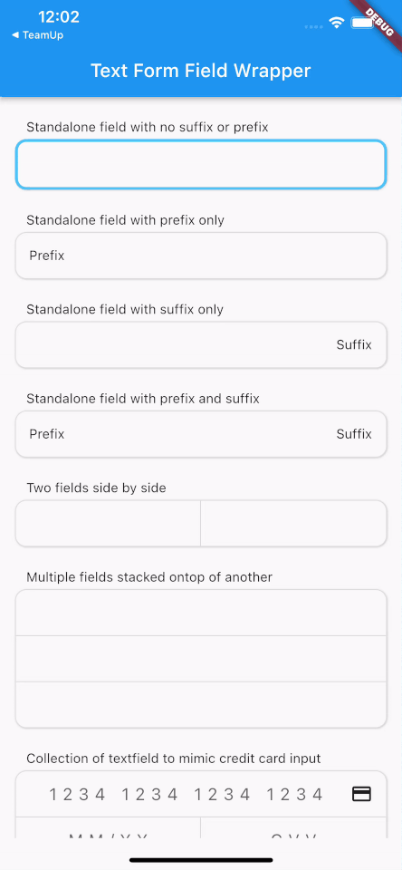

A widget that wraps a `TextFormField` and draws connected borders with corner
radii that adapt to each field's position in a group.



## Installation

Add the dependency to your app's `pubspec.yaml`:

```yaml
dependencies:
  text_form_field_wrapper: ^2.0.0
```

Import the package:

```dart
import 'package:text_form_field_wrapper/text_form_field_wrapper.dart';
```

## Usage

### Standalone field

```dart
TextFormFieldWrapper(
  formField: TextFormField(
    controller: myController,
    decoration: const InputDecoration(border: InputBorder.none),
  ),
  position: TextFormFieldPosition.alone,
)
```

### Grouped fields

Use `position` to control how connected borders are rendered.

```dart
Column(
  children: [
    TextFormFieldWrapper(
      formField: TextFormField(
        controller: cardNumberController,
        decoration: const InputDecoration(border: InputBorder.none),
      ),
      position: TextFormFieldPosition.top,
    ),
    Row(
      children: [
        Expanded(
          child: TextFormFieldWrapper(
            formField: TextFormField(
              controller: expiryController,
              decoration: const InputDecoration(border: InputBorder.none),
            ),
            position: TextFormFieldPosition.bottomLeft,
          ),
        ),
        Expanded(
          child: TextFormFieldWrapper(
            formField: TextFormField(
              controller: cvvController,
              decoration: const InputDecoration(border: InputBorder.none),
            ),
            position: TextFormFieldPosition.bottomRight,
          ),
        ),
      ],
    ),
  ],
)
```

## Notes

- Set your inner `TextFormField` decoration border to `InputBorder.none`.
- `ColumnFormFieldItem` is a data holder intended for `ColumnOfWrappedTextFields`.

## Migration from 1.x to 2.0.0

### Breaking changes

- Minimum SDKs are now Dart `>=3.11.0 <4.0.0` and Flutter `>=3.41.0`.
- `ColumnFormFieldItem` is now a data holder class and is no longer a widget.

### Migration tips

- If your app is on older Flutter/Dart, upgrade your app SDK first.
- If you previously treated `ColumnFormFieldItem` like a widget, replace that usage with `TextFormFieldWrapper` in widget trees and keep `ColumnFormFieldItem` only as configuration data in `ColumnOfWrappedTextFields`.
- Keep `InputBorder.none` on wrapped `TextFormField` decorations.

## Theming overrides (defaults unchanged)

Version `2.0.0` adds optional fill-color overrides while preserving legacy
defaults when not provided.

```dart
TextFormFieldWrapper(
  formField: TextFormField(
    decoration: const InputDecoration(border: InputBorder.none),
  ),
  fillColor: Colors.grey.shade50,
  disabledFillColor: Colors.grey.shade100,
)
```

If you do not set these properties, the widget keeps the same visual defaults as before.

## Contributing and issues

- Found a bug? Open an issue at [https://github.com/jonesw5/text_form_field_wrapper/issues](https://github.com/jonesw5/text_form_field_wrapper/issues).
- Want to add a feature? Open a pull request at [https://github.com/jonesw5/text_form_field_wrapper/pulls](https://github.com/jonesw5/text_form_field_wrapper/pulls).