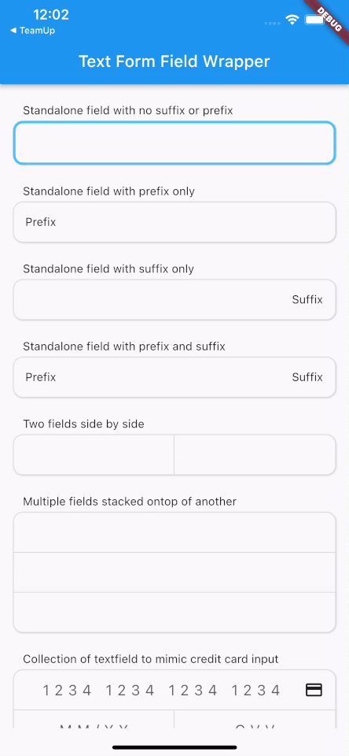

A widget that wraps a `TextFormField` and draws a border with corner radii that
adjust when fields sit against each other.



## Installation

Add the dependency to your app's `pubspec.yaml`:

```yaml
dependencies:
  text_form_field_wrapper: ^2.0.0
```

Requires Dart `^3.13.0` and Flutter `>=3.47.0`. Apps on older SDKs stay on 1.1.0 or 1.0.1.

`ColumnFormFieldItem` is configuration for `ColumnOfWrappedTextFields`. It is not a widget. Use `TextFormFieldWrapper` in the widget tree.

```dart
import 'package:text_form_field_wrapper/text_form_field_wrapper.dart';
```

## Usage

Set the inner field's border to `InputBorder.none`. The wrapper draws the border.

### Standalone field

```dart
TextFormFieldWrapper(
  formField: TextFormField(
    controller: myController,
    decoration: const InputDecoration(border: InputBorder.none),
  ),
  position: TextFormFieldPosition.alone,
)
```

### Grouped fields

`position` chooses which corners are rounded and which edges are shared with a
neighbor. Adjacent fields keep a single seam.

```dart
Column(
  children: [
    TextFormFieldWrapper(
      formField: TextFormField(
        controller: cardNumberController,
        decoration: const InputDecoration(border: InputBorder.none),
      ),
      position: TextFormFieldPosition.top,
    ),
    Row(
      children: [
        Expanded(
          child: TextFormFieldWrapper(
            formField: TextFormField(
              controller: expiryController,
              decoration: const InputDecoration(border: InputBorder.none),
            ),
            position: TextFormFieldPosition.bottomLeft,
          ),
        ),
        Expanded(
          child: TextFormFieldWrapper(
            formField: TextFormField(
              controller: cvvController,
              decoration: const InputDecoration(border: InputBorder.none),
            ),
            position: TextFormFieldPosition.bottomRight,
          ),
        ),
      ],
    ),
  ],
)
```

`ColumnOfWrappedTextFields` stacks `ColumnFormFieldItem`s and assigns `top`,
`center`, and `bottom` for you. `ColumnFormFieldItem` is configuration for that
column, not a field you place in the tree yourself.

## Appearance

Fill, border, and shadow come from the surrounding `Theme`. Borders meet a 3:1
contrast against the fill and the scaffold. Pass `fillColor`,
`borderColor`, or a `TextFormFieldWrapperTheme` to override them.

`left` and `right` positions follow the writing direction, so a leading cell
keeps its rounded corner on the outer edge in right-to-left layouts.

When `isEnabled` is omitted, the wrapper follows `formField.enabled`.

Focus changes the border color and thickness. It does not move the field or
change the wrapper's size.

### Validation

`errorText` is painted under the border. The filled box keeps its height, so a
neighboring field does not jump.

```dart
TextFormFieldWrapper.builder(
  validator: (value) => value == null || value.isEmpty ? 'Required' : null,
  fieldBuilder: (state) {
    return TextField(
      onChanged: state.didChange,
      decoration: const InputDecoration(border: InputBorder.none),
    );
  },
)
```

### Previous light colors

```dart
TextFormFieldWrapper(
  fillColor: Colors.grey.shade50,
  disabledFillColor: Colors.grey.shade100,
  borderColor: Colors.grey.shade300,
  borderFocusedColor: Colors.lightBlue.shade300,
  shadowColor: Colors.grey,
  formField: field,
)
```

## Issues

Report bugs and open pull requests on
[GitHub](https://github.com/OfficialFlutterButter/text_form_field_wrapper/issues).
See [CONTRIBUTING.md](CONTRIBUTING.md) for how releases are published.
